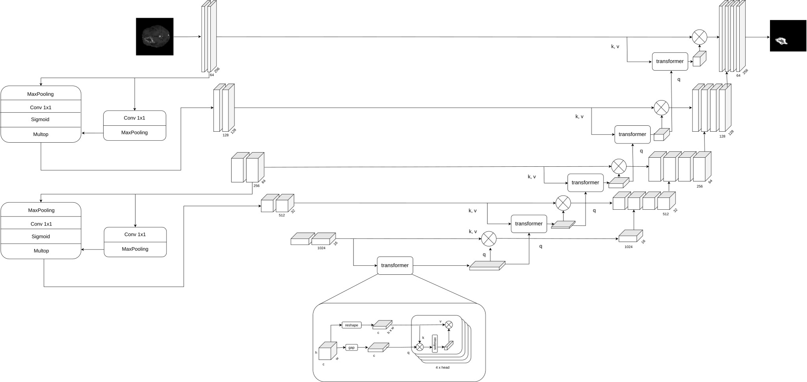

# Brain Tumor Segmentation - BRISC 2025

## 🎯 Overview

This project tackles the `BRISC 2025 brain tumor segmentation challenge` by developing a robust deep learning pipeline that segments brain tumors from medical imaging data. Our solution tries to modify `The Lighweight TransNet` using `Spatial Attention`, `Combo loss` and `Data Augmentation`, `Test-Time Augmentation` to achieve high accuracy in tumor segmentation.

---

## 🏗️ Architecture
<picture>
  <!-- Dark mode -->
  <source srcset="docs/img/SA-TransUNet-Dark.svg" media="(prefers-color-scheme: dark)">
  
  <!-- Light mode -->
  <source srcset="docs/img/SA-TransUNet-Light.svg" media="(prefers-color-scheme: light)">
  
  <!-- REQUIRED fallback -->
  
</picture>

### Key Components:

1. **CNN Encoder:** Extracts fine, local features using standard DoubleConv layers.
2. **Spatial Attention:** Actively focuses the network on relevant tumor regions.
3. **Transformer Bottleneck:** Captures long-range global dependencies using multi-head self-attention.
4. **Multi-Scale Transformers:** Dynamically weights skip connection features before fusion.
5. **CNN Decoder:** Progressively upsamples and concatenates features for the final mask.
---

## 🔧 Installation

### Prerequisites
- Python 3.12.13
- CUDA 12.8 (for GPU support)
- pip package manager

### Setup

```bash
# Clone the repository
git clone https://github.com/mohassan5286/Brain-Tumor-Segmentation---BRISC-2025.git
cd Brain-Tumor-Segmentation---BRISC-2025

# Install dependencies
pip install -r requirements.txt
```

### Dependencies
- PyTorch 2.10 (cu128)
- torchvision
- torchmetrics
- Pillow
- NumPy

---

## 📊 Dataset

The dataset structure should follow this format:

```
root_directory/
├── train/
│   ├── images/
│   │   ├── image_1.jpg
│   │   ├── image_2.jpg
│   │   └── ...
│   └── masks/
│       ├── image_1.png
│       ├── image_2.png
│       └── ...

└── test/
│   ├── images/
│   │   ├── image_1.jpg
│   │   ├── image_2.jpg
│   │   └── ...
│   └── masks/
│       ├── image_1.png
│       ├── image_2.png
│       └── ...
```

**Note**: Images are processed in grayscale (single channel) with 256×256 resolution.
---

## 🚀 Usage

### Training

```bash
python train_seg.py \
  --data_dir /path/to/segmentation_task \
  --bsz 32 \
  --niter 100 \
  --lr 0.0001
```

### Testing/Inference

```bash
python test_seg.py \
  --data_dir /path/to/test/images \
  --model_path /path/to/trained_model.pth \
  --bsz 32 \
```

### Test-Time Augmentation/Inference

```bash
python tta_inference.py \
  --data_dir /path/to/test/images \
  --model_path /path/to/trained_model.pth \
  --bsz 32 \
```

---

## Paper
You can access the research paper here:  
🔗 **[Read the Paper](https://drive.google.com/file/d/1KfAI8ggjQ6gt8sopEEArnRtkiieXMDYm/view?usp=sharing)**

---

## Checkpoint
You can download the best pre-trained SA-TransUNet model weights for evaluation here:  
🔗 **[Best Model Checkpoint (Google Drive)](https://drive.google.com/drive/folders/1eUHbgVAuqDQPBty_Rz8PPsF9EIr_IwAe?usp=sharing)**


---

## 📄 License

This project is open source and available under the MIT License.

---

## 🤝 Contributing

Contributions are welcome! Please feel free to submit a Pull Request with improvements, bug fixes, or new features.

---
